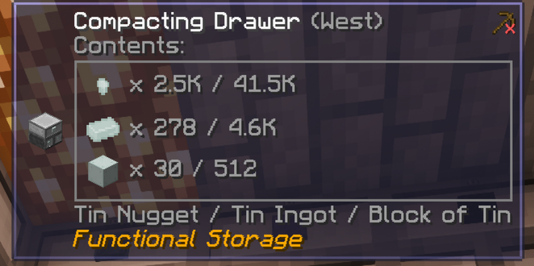

# Drawer Names for Jade

A small client-side add-on for Minecraft 1.21.1 on NeoForge. Functional Storage's Jade tooltip shows its item drawers as icons and counts only, so you can't tell what a compacting drawer holds without opening it ([Functional Storage issue #472](https://github.com/Buuz135/FunctionalStorage/issues/472)). This adds one line under the icon box that names the contents.



- **Compacting drawers:** the nugget, ingot and block names, joined with " / ".
- **Normal drawers:** the names of the stored items.
- **Read only.** It never touches drawer data, and any error inside its tooltip code is swallowed, so it cannot crash the client.
- **Not handled:** Ender drawers are not specially supported and may show no name line. Fluid drawers already show their fluid name in Functional Storage's own tooltip.

## Requirements

- Minecraft 1.21.1, NeoForge 21.1 or later
- [Jade](https://modrinth.com/mod/jade) 15 or later
- [Functional Storage](https://modrinth.com/mod/functional-storage) 1.5 or later (and its dependency, Titanium)

Tested with Jade 15.10.6 and Functional Storage 1.5.8 in FTB Evolution. Drop the jar into `mods/`. It is only needed on the client, and nothing is added to worlds.

## Build

Use a JDK 21 for Gradle (Groovy build scripts fail on newer Java):

```
JAVA_HOME=/path/to/jdk21 ./gradlew build
```

The jar lands in `build/libs/`. The Jade, Functional Storage and Titanium jars are read at compile time only from a mods folder: set it with `-PmodsDir=<folder>`, or it defaults to the Prism Launcher "FTB Evolution" instance. Nothing from those mods is bundled.

## Status

Compiles and works in-game. The source was reviewed by a second model with no bugs found, and has had no automated tests.

## Licence and credits

MIT, see `LICENSE`. This is an independent add-on, not affiliated with the authors of Jade or Functional Storage. Jade is CC-BY-NC-SA 4.0 and Functional Storage is MIT, and nothing from either mod is bundled.

It uses Jade's public API, but Functional Storage has no public API, so it reads that mod's internal classes (`ItemControllableDrawerTile`, `CompactingInventoryHandler`, `BigInventoryHandler`). A Functional Storage update that changes them may break this add-on.

Written with Claude Code assistance.
